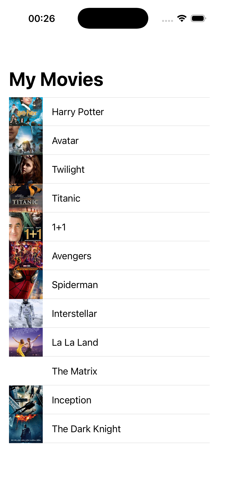
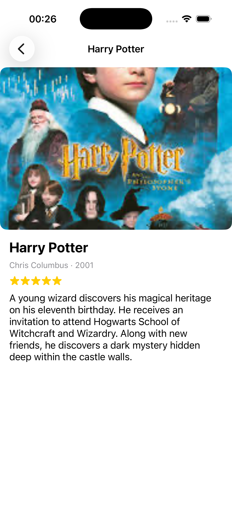

# Favorites Navigator

iOS lab project built with Swift (UIKit / Storyboard) demonstrating navigation via `UINavigationController` and data passing between screens.

## Features & Implementation

- **Data Model (`Movie.swift`):** Stores 20 curated movies in `MovieStore` with titles, subtitles (director and year), custom posters, star ratings (0–5), and 3+ sentence descriptions.
- **List Screen (`ViewController`):**
  - Wrapped in a `UINavigationController` with large title support.
  - Custom `MovieCell` prototype displaying only the poster and title.
  - Automatic row deselection upon return.
- **Detail Screen (`DetailViewController`):**
  - Navigation via `showDetail` segue using `prepare(for:sender:)` for data transfer.
  - Full-width poster image header with proper aspect scaling.
  - Displays title, subtitle, star rating, and multi-line description.

## Screenshots

| List Screen | Detail Screen |
| :---: | :---: |
|  |  |