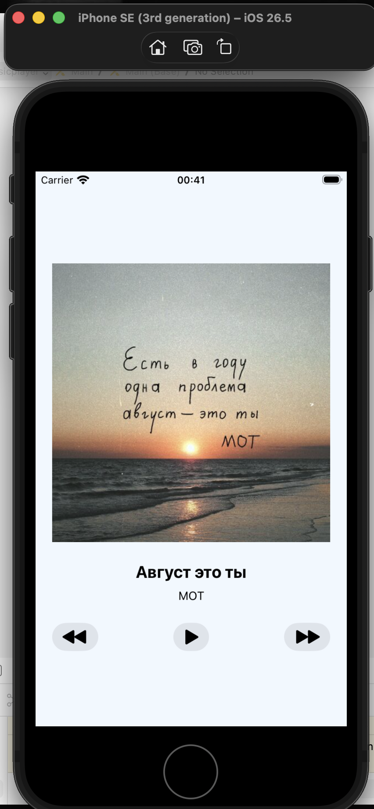
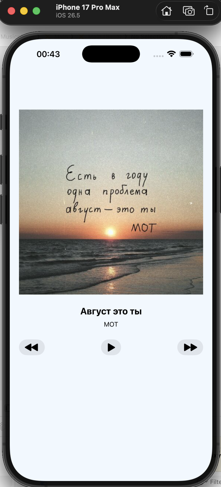

# 🎵 iOS Music Player — UIKit & Auto Layout

A single-screen iOS music player built with UIKit, `UIStackView`, Auto Layout, and `AVAudioPlayer` for a university lab assignment.

---

## 📱 Screenshots

| iPhone SE (3rd generation) | iPhone 16 Pro Max |
|:-------------------------:|:-----------------:|
|  |  |

---

## ✨ Features & Functionality

* **10-Track Playlist:** Audio files (`.mp3`) bundled directly into the app target.
* **Playback Controls:** `Previous`, `Play/Pause`, `Next` buttons using SF Symbols (`backward.fill`, `play.fill` / `pause.fill`, `forward.fill`).
* **Auto-Advance:** Automatically plays the next track when the current song finishes via `AVAudioPlayerDelegate`.
* **Playlist Wrap-Around:** Pressing `Next` on the last track loops to the first, and `Previous` on the first track loops to the last.
* **State Persistence:** Preserves play state across track changes (if audio was playing, switching tracks starts playback immediately).
* **Safe Error Handling:** Graceful handling of missing files with `guard let` and `try?` to avoid app crashes.

---

## 📐 Layout & Auto Layout Architecture

* **100% Storyboard Layout:** Zero programmatic layout constraints (`NSLayoutConstraint`, anchors, or `frame` calls in Swift).
* **Nested Stack Views:** Uses 3 nested `UIStackView` instances:
  1. **Text Stack (Vertical):** Holds track title and artist `UILabel`s.
  2. **Controls Stack (Horizontal):** Holds action buttons (`Previous`, `Play/Pause`, `Next`).
  3. **Root Stack (Vertical):** Parent container encapsulating cover art, text stack, and control stack.
* **Constraints:**
  * Root stack pinned to Safe Area with 20 pt leading/trailing margins and vertically centered.
  * Square cover image (`UIImageView`) strictly enforces a **1:1 Aspect Ratio** across all iPhone screen sizes.
* **Zero Warnings:** Clean Auto Layout setup with 0 warnings or conflict errors in Interface Builder.