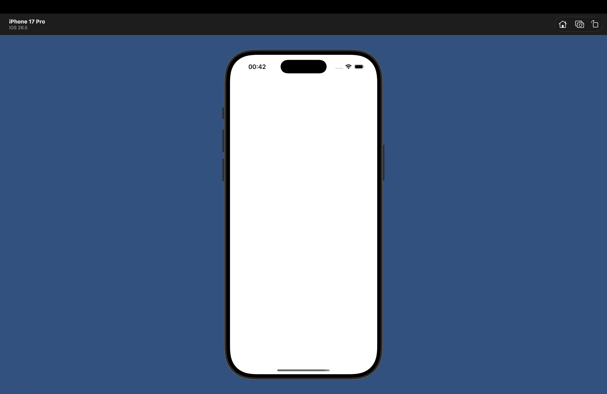
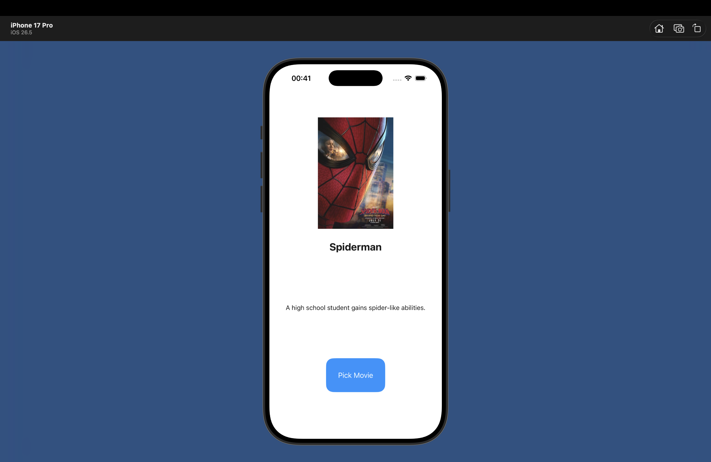

# IOS-Development-Fall-26

# Lab 6: Favorites Roulette (MovieApp)

Single-screen iOS application that displays a random favorite movie card without consecutive repeats.

## Features & Criteria
- **Language:** Swift / UIKit
- **UI:** Main.storyboard without Auto Layout
- **Data Model:** Array of `Movie` structs (10 items)
- **Safety:** No force unwrapping (`if let` image binding)

## Screenshots
| Launch Screen | Main Screen | Home Screen Icon |
|:---:|:---:|:---:|
|  |  |  |
