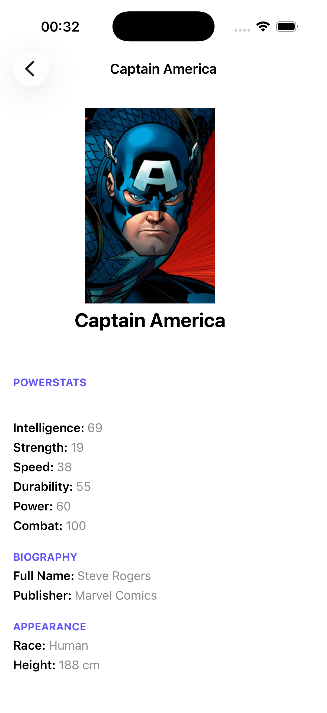
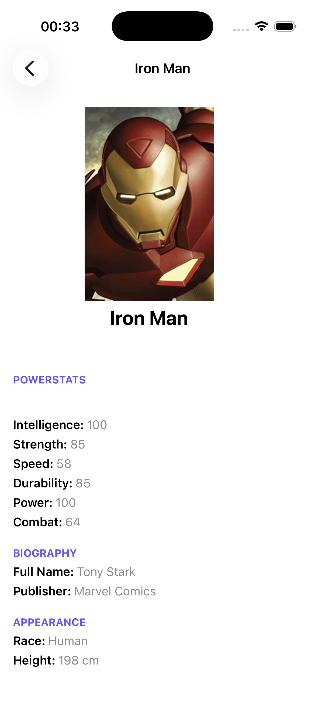

# Superheroes App

**Student:** Adel Kikbay

## Description
A two-screen iOS app built with UIKit and Storyboard that loads all superheroes from the Superhero API using `URLSession` and `Codable`[cite: 1]. The first screen displays the list of heroes with gender SF Symbol icons, and tapping a row opens a detail screen with the hero's image and 10 properties from 3 JSON groups

## Chosen Properties (10 properties across 3 groups)
1. **Intelligence** (`powerstats`) — formatted text label (`UILabel`).
2. **Strength** (`powerstats`) — formatted text label (`UILabel`).
3. **Speed** (`powerstats`) — formatted text label (`UILabel`).
4. **Durability** (`powerstats`) — formatted text label (`UILabel`).
5. **Power** (`powerstats`) — formatted text label (`UILabel`).
6. **Combat** (`powerstats`) — formatted text label (`UILabel`).
7. **Full Name** (`biography`) — formatted text label with fallback to `"Unknown"`.
8. **Publisher** (`biography`) — formatted text label with fallback to `"Unknown"`.
9. **Race** (`appearance`) — formatted text label with fallback to `"Unknown"`.
10. **Height** (`appearance`) — metric height displayed in a text label with fallback to `"Unknown"`.

## Screenshots
| Heroes List | Detail Page 1 | Detail Page 2 |
| :---: | :---: | :---: |
|  |  |  |