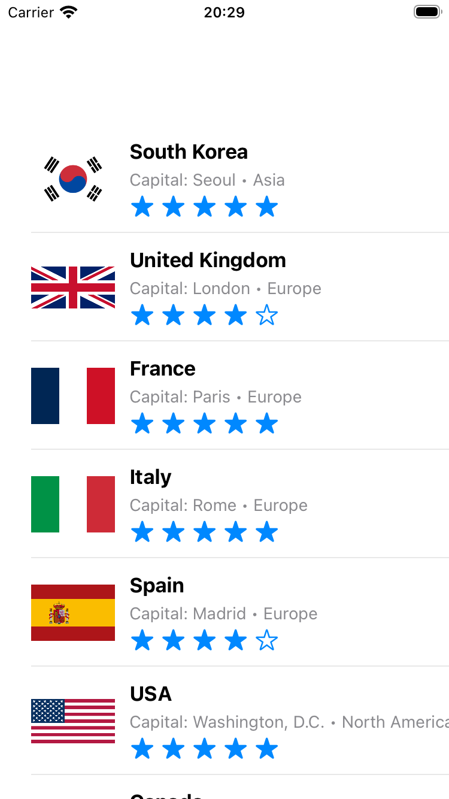
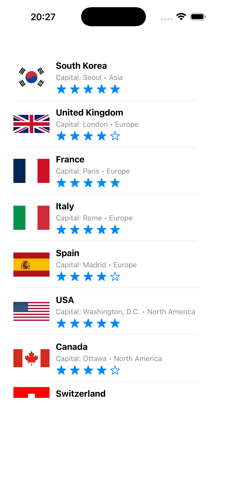
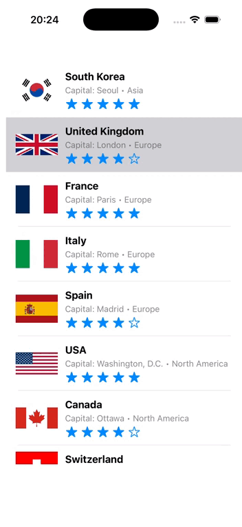

# Lab: Favorites List — UITableView & Custom Cells

A UIKit application built with Swift that displays a list of 20 favorite countries using a `UITableView` with a custom prototype cell (image, title, subtitle, and an SF Symbols rating indicator).

## Screenshots

| iPhone SE (3rd generation) | iPhone 17 Pro Max |
|:-------------------------:|:-----------------:|
|  |  |

## Demo Video

